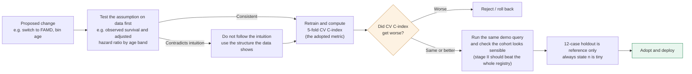
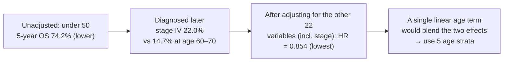

# Development History: How We Got to the Current Version

> Project CRC-ORACLE (腸命天機) · How the system evolved, why each change was made, and how each change was evaluated.
> Every number below comes from a file in this repo or from the git log, and the source is cited. Where the repo has no record, this page says so instead of guessing.
>
> 繁體中文版：[發展歷程.md](發展歷程.md)

---

## 1. Version evolution

```mermaid
flowchart TD
    A["<b>Aug 15 · v1 prototype</b><br/>Natural-language front end + PCA/KM engine<br/>First 3 PCs explain 34.4% of variance"]
    B["<b>Aug 19 · v2 data rerun</b><br/>PCA/KM recomputed on v2 synthetic data, 12 cases held out<br/>16 features · first 3 PCs 48.6%"]
    C["<b>Aug 21 · Adjusted after physician feedback</b><br/>Renamed to CRC-ORACLE"]
    D["<b>PCA v3</b><br/>23 features (T/N/M substages, node ratio, pre-op labs…)<br/>5-fold CV C-index 0.7962"]
    E["<b>Aug 25 · FAMD v3</b><br/>Categorical variables keep their labels instead of being forced to ordinal codes<br/>5-fold CV C-index 0.7978"]
    F["<b>~Aug 25–26 · Similar-cohort search redesigned</b><br/>Fixed K=100 → radius that grows until enough death events<br/>Cohort size clamped to 30–300 · user-adjustable radius"]
    G["<b>Sep 3 · v3.1 age in 5 strata (current model)</b><br/>Age changes from a continuous to a categorical variable<br/>5-fold CV C-index 0.7995"]
    H["<b>Sep 3–9 · Interface finalized</b><br/>Chinese/English switch · fields renamed to data dictionary<br/>Clinical-use disclaimer"]
    I["<b>Oct 27 · PWA (current deployment)</b><br/>Installable and works offline · mobile header fix"]

    A --> B
    B --> C
    C -->|"16 features lacked key prognostic factors<br/>such as T/N/M substages → expanded to 23"| D
    D -->|"Linear PCA needs stage codes mapped to numbers by hand,<br/>which assumes distances between categories are meaningful"| E
    E -->|"Fixed K ignores how many comparable patients are nearby;<br/>a fixed 0.1–0.5 SD radius is not workable (0 patients at 0.1 SD)"| F
    F -->|"Measured survival is not linear in age"| G
    G --> H
    H --> I

    style G fill:#e1f0fd,stroke:#0976c0,stroke-width:2px
    style I fill:#e8f6ee,stroke:#0f7a45,stroke-width:2px
```

**How to read it:** top to bottom is chronological. The text on each arrow is *why* the project moved to the next step. Blue is the current model; green is the current deployment.
Sources: `git log` (commit dates), `02_model_模型/*/README.md`, `04_docs_文件/archive_封存/README_舊版_PCA時期.md`.

> PCA v3 is documented as a training-results write-up (`02_model_模型/archive_famd_20260823_舊版/README.md`) with no commit of its own, so it carries no date. The content of the Aug 21 physician feedback is not documented in the repo.

### 1.1 Trend and key events

Each node is one event, in order. Blue nodes are model changes and carry the 5-fold CV C-index (the adopted metric) and its change from the previous version; the small chart at the top shows the same trend. The pills between nodes are real calendar days, so the burst of work in the first three weeks and the long quiet stretch after it are both visible. PCA v3 has no recorded date, so it is drawn with a dashed ring. The image is generated by [`figures/make_timeline.py`](figures/make_timeline.py) (`pip install playwright && playwright install chromium`).

### 1.2 Why each change was made

| Change | Why | Evidence in the repo | Outcome |
|---|---|---|---|
| v1 → v2 data rerun (Aug 19) | Recompute on the v2 synthetic dataset with 12 cases held out for validation. The reason for moving to v2 is not documented. | commit `3e0d71b` | Basis for all later versions |
| Physician feedback (Aug 21) | A physician asked for adjustments; what was asked is not documented. | commit `4a817ac` | Renamed to CRC-ORACLE |
| 16 → 23 features (PCA v3) | The 16 features lacked T/N/M substages, lymph-node ratio and other key prognostic factors, so "similar" in PCA space disagreed with clinical intuition. | PCA v3 README | 5-fold CV C-index 0.7962; demo cohort 5-year OS 85.3% vs. 69.8% for all |
| PCA → FAMD v3 (Aug 25) | PCA needs stage codes mapped to numbers by hand (T4a=4, T4b=4.5), which assumes distances between categories are meaningful. | FAMD section of the model README | CV 0.7978, "statistically the same level"; the cohort is less concentrated on right-sided tumors |
| Fixed K=100 → adaptive radius | A fixed K ignores how many comparable patients are nearby; a fixed 0.1–0.5 SD radius found 0 patients at 0.1 SD and 11 at 0.3 SD. | Adaptive-search section of the model README | Cohort grows until ≥ 20 death events, clamped to 30–300 |
| Continuous age → 5 strata (Sep 3) | Measured survival is not linear in age; a linear "younger = higher weight" assumption was tested and rejected. | Age appendix | CV 0.7978 → 0.7995 |
| Chinese/English switch (Sep 3) | So English-speaking physicians can use the tool directly. | commit `ce7b64b` | Language is remembered per browser |
| PWA and mobile header fix (Oct 27) | Make the site installable and usable offline on phones and desktops; the header collapsed at phone width. | commit `d43b5ed` | Installable app; works offline |

Reasons marked "not documented" are gaps in the written record, not omissions in this page.

---

## 2. Evaluation at a glance

| Version | Features | Train C-index | **5-fold CV C-index** | 12-case holdout | Cumulative explained variance |
|---|---|---|---|---|---|
| v1 (Aug 15) | — | not recorded | not recorded | — | first 3 PCs 34.4% |
| v2 (Aug 19) | 16 | not recorded | not recorded | — | first 3 PCs 48.6% |
| PCA v3 | 23 (categoricals as ordinals) | 0.7972 | **0.7962** | 0.7568 | first 3 PCs 39.6% |
| FAMD v3 | 23 (11 continuous + 12 categorical) | 0.7993 | **0.7978** | 0.7568 | first 3 PCs 24.2% |
| **FAMD v3.1 (current)** | 23 (10 continuous + 13 categorical, age binned) | 0.8011 | **0.7995** | 0.7027 | first 3 PCs 22.60%; first 5 PCs 31.35% |

Sources: `archive_famd_20260823_舊版/README.md`, `current_famd_age-layered_年齡分層版/README.md`, `famd_coefficients_v3.json` (`cox_model`), `03_website/deploy/README.md`.

**Three things in this table are not comparable across rows:**

1. **Explained variance does not compare across methods.** FAMD's denominator is the total inertia of the expanded indicator matrix, which grows with the number of categories, so its percentages are naturally lower than linear PCA's. That does not mean it captures less information.
2. **The holdout is only 12 patients.** About 6 events, with a bootstrap 95% CI of [0.44, 1.0]. The drop from 0.7568 to 0.7027 should not be read as the model getting worse. Formal evaluation uses 5-fold CV.
3. **C-index measures the Cox survival model, not the similar-cohort search** (see §5).

---

## 3. How a change is evaluated (as practiced in the docs)

> This diagram summarizes the practice described across the model READMEs. **It is not a formally agreed team procedure.** It rests on three statements in those docs: use 5-fold CV for formal reporting; always state that holdout n=12 is tiny; compare against the previous version on the same query.

---

## 4. Each change: why, how it was checked, what happened

### 4.1 v1 → v2 (Aug 15 → Aug 19)
- **What:** The natural-language front end was connected to the team's PCA/KM engine (engine code untouched; only the input layer in front of it was new). On Aug 19 everything was recomputed on the v2 synthetic data with 12 cases held out for validation.
- **Limitations at the time** (`README_舊版_PCA時期.md`): KM curves used per-stage 1/3/5-year landmark numbers, and in the front-end-only demo the cohort distribution was simulated. De-identification broke clinical relationships between fields, so survival figures were for workflow demonstration only.

### 4.2 16 → 23 features (PCA v3)
- **Why:** The 16-feature version had no T/N/M substages or lymph-node positivity ratio, so "similar" in PCA space disagreed with clinical intuition.
- **What was added:** T/N/M substages, node ratio, tumor appearance and size, circumferential invasion, resection margin, curative intent and timing of surgery, CEA / albumin / hemoglobin.
- **Check:** 5-fold CV C-index 0.7962. On the demo query (68-year-old male, stage II ascending-colon adenocarcinoma) the similar cohort's 5-year OS was 85.3% against 69.8% for the whole registry, which is the expected direction.
- **Note:** These 23 features were chosen from prognostic-factor literature, and the write-up asks to reconcile them with the statisticians' own list (`FEATURES` in `train_v3.py`).

### 4.3 PCA → FAMD v3 (Aug 25)
- **Why:** Linear PCA requires mapping categories such as T4a=4, T4b=4.5 to numbers by hand, which assumes distances between categories mean something. That is not reasonable for unordered or unevenly spaced stage codes.
- **What:** The 11 continuous variables follow PCA logic; the 12 categorical variables keep their labels and are encoded through an indicator matrix.
- **Check:** 5-fold CV 0.7962 → 0.7978, which the write-up calls "statistically the same level".
- **Trade-off the docs record:** On the same query, the FAMD cohort is less concentrated on right-sided tumors than the PCA cohort (about half of 100 patients were left-sided). FAMD weights categories by their frequency in the population, whereas PCA used hand-assigned values. The write-up describes the two as defining "similar" differently: PCA carries stronger clinical assumptions, FAMD is more data-driven.
- **FAMD is the current method.** The decision discussion itself is not in the repo; only the comparison above is.

### 4.4 Similar-cohort search redesign
- **Why:** A fixed K=100 says nothing about how many comparable patients actually sit near the index patient.
- **How:** Each component axis is divided by its training-set standard deviation and combined into one distance. The search starts at 0.5 SD and widens until the cohort holds at least 20 death events, with cohort size clamped to [30, 300]. (The Aug 26 handoff doc lists an upper bound of 100; it was later relaxed to 300.)
- **Why not just fix a radius of 0.1–0.5 SD:** The space is 5-dimensional, so two random patients are about √5 ≈ 2.24 SD apart. Measured: 0.1 SD returned 0 patients, 0.3 SD only 11, and 0.5 SD was the first radius that meant anything.
- **Honest empty states:** If the cap is reached without enough events, the API returns `low_confidence`. If a manually set radius contains nobody, the page says so and shows the distance to the nearest patient instead of quietly substituting the nearest N.

### 4.5 FAMD v3 → v3.1, age in 5 strata (Sep 3)
- **The team's initial idea:** Weight younger age more heavily with a linear adjustment.
- **Checked against the data first.** The relationship is not linear:

  | | `<50` | `50-60` | `60-70` | `70-80` | `80+` |
  |---|---|---|---|---|---|
  | Patients | 1,698 | 2,784 | 3,490 | 2,673 | 1,551 |
  | Raw 5-year OS (unadjusted) | 74.2% | 76.8% | 76.3% | 65.5% | 45.3% |
  | Cox adjusted HR (reference 50-60) | 0.854 | 1.000 | 0.947 | 1.379 | **2.310** |

- **The apparent contradiction:** Unadjusted, `<50` sits in the middle; after adjusting for the other 22 variables it has the lowest risk. The reason is that younger patients are diagnosed at a later stage (stage IV 22.0% vs. 14.7% at 60–70). Their poor raw survival comes from late diagnosis, not from age itself.

- **Result:** 5-fold CV C-index 0.7978 → 0.7995 (small but real).
- **Compatibility:** Total feature count stays 23 (continuous 11→10, categorical 12→13), and the API still accepts `AGE=68` and bins it internally.

### 4.6 Interface and deployment (Sep 3 → Oct 27)
Chinese/English switch (Sep 3), "official codebook" renamed "data dictionary" (Sep 3), repo layout aligned with the local project and `vercel.json` added to fix a 404 (Sep 8), clinical interface finalized (Sep 9), social link preview (Oct 2), PWA and mobile header fix (Oct 27). None of these change the model. Source: `git log`.

---

## 5. Easy to get wrong

| Claim | Safe to say? |
|---|---|
| Age binning improved the Cox model's discrimination (CV 0.7978 → 0.7995) | ✅ Yes |
| Age binning made similar-cohort search more accurate | ❌ **The data do not support this.** The Cox model uses the raw 23 features and never touches FAMD coordinates. `age_group` ranks 11th or lower in contribution on all five components (19th on PC1); stage variables (TNM, T, N, M, curative intent) dominate. PC1's `TNM_stage` contributes 53× more than `age_group` |
| Holdout fell from 0.7568 to 0.7027, so the model got worse | ❌ n=12 with a CI of [0.44, 1.0]; this cannot be read as a change |
| FAMD explains 22.60% vs. PCA's 39.6%, so it keeps less information | ❌ Different denominators; not comparable |
| Early-onset colorectal cancer is intrinsically more aggressive, so under-50 carries higher risk | ⚠️ **Not what this dataset shows.** Adjusted risk is lowest for `<50`; the poor raw survival comes from later-stage diagnosis |

### Known documentation discrepancy (the appendix is treated as authoritative)
The "v3.1 update" section of `02_model_模型/current_famd_age-layered_年齡分層版/README.md` uses `<50` as the reference group and attributes higher risk in the youngest group to more aggressive early-onset tumors. `04_docs_文件/年齡分層方法學附錄.md` uses 50-60 as the reference, states that its numbers were computed from `artifacts_famd.pkl`, and concludes that `<50` has the lowest adjusted risk because of later-stage diagnosis. **The two do not agree; this page follows the appendix.** The model README section should be rechecked against the pickle.

---

## 6. Data and limitations

- The data are **AI de-identified synthetic data** (12,250 rows × 197 columns; 42 rows with follow-up ≤ 0 days and 12 holdout cases removed, leaving 12,196 patients available for matching). De-identification distorts clinical relationships between fields. **This is for methodology demonstration and research prototyping only: not for clinical decisions, and not citable as a clinical result.**
- The website is a single HTML file with the full patient matrix and the FAMD encoder embedded. Anything deployed publicly can be downloaded in full, so a build containing real patient records must never be deployed this way.

---

## 7. Source index

| Topic | File |
|---|---|
| Dates and commits | `git log` |
| v1 prototype and its limits | `04_docs_文件/archive_封存/README_舊版_PCA時期.md` |
| PCA v3, FAMD v3 comparison, search logic, v3.1 | `02_model_模型/archive_famd_20260823_舊版/README.md`, `02_model_模型/current_famd_age-layered_年齡分層版/README.md` |
| Age-strata HRs, stage mix, contribution ranks | `04_docs_文件/年齡分層方法學附錄.md` |
| Current C-index and explained variance | `famd_coefficients_v3.json`, `03_website/deploy/README.md` |
| Search parameters as of Aug 26 (upper bound 100) | `04_docs_文件/archive_封存/PPT交接文件_給下一個對話.md` |
