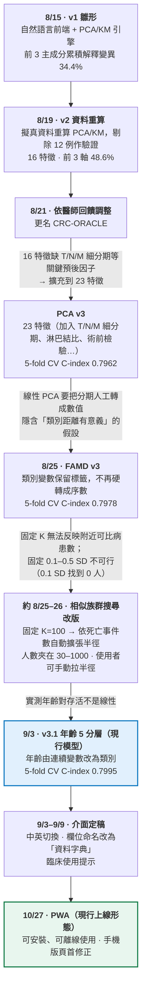
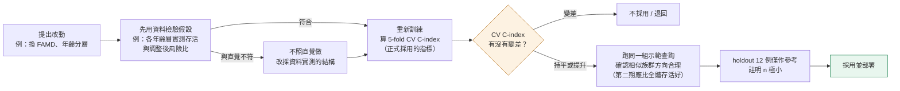

# 發展歷程：為什麼走到現在這個版本

> Project CRC-ORACLE（腸命天機）· 本文整理「版本怎麼演變、每次為什麼改、用什麼評估」。
> 所有數字都來自 repo 內的檔案或 git 紀錄，來源標在每一段。查不到來源的地方會直接寫「文件未記載」，不補猜測。
>
> English version: [DEVELOPMENT_HISTORY.md](DEVELOPMENT_HISTORY.md)

---

## 1. 版本演變總圖

**怎麼讀這張圖**：由上往下是時間順序，箭頭上的文字是「為什麼走到下一步」。藍框是現行模型版本，綠框是現行上線形態。
來源：`git log`（commit 日期）、`02_model_模型/*/README.md`、`04_docs_文件/archive_封存/README_舊版_PCA時期.md`。

> PCA v3 是模型訓練結果文件（見 `02_model_模型/archive_famd_20260823_舊版/README.md`），repo 內沒有它獨立的 commit，所以圖上沒標日期。8/21 醫師回饋的具體內容，repo 內文件未記載。

### 1.1 趨勢與關鍵事件

每個節點是一個事件，依時間排序。藍色節點為模型改版，卡片上標出 5-fold CV C-index（正式採用的指標）與相對前一版的變化；上方小圖是同一條趨勢。節點之間的色塊是實際日曆天數，所以前三週密集改版、之後放慢的節奏一眼可見。PCA v3 在 repo 內沒有記載日期，所以用虛線圓圈表示。圖由 [`figures/make_timeline.py`](figures/make_timeline.py) 產生（`pip install playwright && playwright install chromium`）。

### 1.2 每次改版的原因

| 改動 | 為什麼改 | repo 內的依據 | 結果 |
|---|---|---|---|
| v1 → v2 資料重算（8/19） | 改用 v2 擬真資料重算，並剔除 12 例作驗證。為什麼換到 v2，文件未記載。 | commit `3e0d71b` | 後續所有版本的基礎 |
| 醫師回饋調整（8/21） | 醫師提出調整；具體內容文件未記載。 | commit `4a817ac` | 更名 CRC-ORACLE |
| 16 → 23 特徵（PCA v3） | 16 特徵缺 T/N/M 細分期、淋巴結比率等關鍵預後因子，PCA 空間裡的「相似」和臨床認知不一致。 | PCA v3 README | 5-fold CV 0.7962；示範族群 5 年 OS 85.3%，全體 69.8% |
| PCA → FAMD v3（8/25） | PCA 要把分期人工轉成數值（T4a=4、T4b=4.5），隱含「類別間距離有意義」的假設。 | 模型 README 的 FAMD 一節 | CV 0.7978，文件判斷為「統計上同一水準」；族群在腫瘤側別上沒那麼集中於右側 |
| 固定 K=100 → 自適應半徑 | 固定 K 無法反映附近可比病患數；固定 0.1–0.5 SD 半徑在 0.1 SD 找到 0 人、0.3 SD 只有 11 人。 | 模型 README 的自適應搜尋一節 | 半徑擴張到累積死亡事件 ≥ 20，人數夾在 30–1000 |
| 連續年齡 → 5 分層（9/3） | 實測存活對年齡不是線性；「年輕者權重較高」的線性假設經檢驗後未採用。 | 年齡分層附錄 | CV 0.7978 → 0.7995 |
| 中英切換（9/3） | 讓英文母語醫師可直接使用。 | commit `ce7b64b` | 語言選擇會記在瀏覽器 |
| PWA 與手機版頁首修正（10/27） | 讓網站可安裝、可離線使用；手機寬度下頁首會塌成直排。 | commit `d43b5ed` | 可安裝的 App；可離線 |

標「文件未記載」的是書面紀錄的缺口，不是本頁遺漏。

---

## 2. 評估數字對照

| 版本 | 特徵組成 | 訓練 C-index | **5-fold CV C-index** | holdout 12 例 | 前幾軸累積解釋變異 |
|---|---|---|---|---|---|
| v1（8/15） | — | 文件未記載 | 文件未記載 | — | 前 3 軸 34.4% |
| v2（8/19） | 16 | 文件未記載 | 文件未記載 | — | 前 3 軸 48.6% |
| PCA v3 | 23（類別轉序數） | 0.7972 | **0.7962** | 0.7568 | 前 3 軸 39.6% |
| FAMD v3 | 23（11 連續 + 12 類別） | 0.7993 | **0.7978** | 0.7568 | 前 3 軸 24.2% |
| **FAMD v3.1（現行）** | 23（10 連續 + 13 類別，年齡分層） | 0.8011 | **0.7995** | 0.7027 | 前 3 軸 22.60%；前 5 軸 31.35% |

來源：`archive_famd_20260823_舊版/README.md`、`current_famd_age-layered_年齡分層版/README.md`、`famd_coefficients_v3.json`（cox_model 欄位）、`03_website/deploy/README.md`。

**這張表有三個不能直接比的地方：**

1. **解釋變異不能跨方法比**。FAMD 的分母包含類別變數展開後的指標矩陣總慣性，類別越多分母越大，百分比天生比線性 PCA 低，不代表抓到的資訊較少。
2. **holdout 只有 12 人**。事件數約 6 例，bootstrap 95% 信賴區間為 [0.44, 1.0]，所以 0.7568 → 0.7027 的下降不能解讀成模型變差。正式評估一律看 5-fold CV。
3. **C-index 是 Cox 模型的指標，不是相似族群搜尋的指標**（見 §5）。

---

## 3. 評估與決策流程（依文件記載的做法整理）

> 這張圖是從各版 README 的做法歸納出來的，**不是團隊正式訂過的 SOP**。依據：「正式報告請以 5-fold CV 為準」「holdout n=12 務必註明樣本數極小」「用同一個查詢跟上一版對照」。

---

## 4. 每次改版：為什麼改、怎麼驗證、結果

### 4.1 v1 → v2（8/15 → 8/19）
- **做什麼**：把自然語言前端接上組員的 PCA/KM 引擎（引擎程式碼沒改，只換前面的輸入介面）；8/19 用 v2 擬真資料重算，並剔除 12 例作為驗證用。
- **當時的限制**（`README_舊版_PCA時期.md`）：KM 曲線用的是各期別 1/3/5 年的 landmark 數字，相似族群分布在純前端 demo 版是模擬的；去識別破壞了欄位間的臨床關聯，存活數字僅供流程示範。

### 4.2 16 特徵 → 23 特徵（PCA v3）
- **為什麼**：16 特徵沒有 T/N/M 細分期、淋巴結陽性比率這些關鍵預後因子，PCA 空間裡的「相似」和臨床認知不一致。
- **怎麼做**：新增 T/N/M 細分期、淋巴結比率、腫瘤外觀與大小、環周侵犯、切除 margin、手術根治性與時機、CEA／白蛋白／血色素。
- **驗證**：5-fold CV C-index 0.7962；示範查詢（68 歲男性、第二期升結腸腺癌）相似族群 5 年 OS 85.3%，全體 69.8%，方向正確。
- **註記**：這 23 個特徵是依預後文獻重新挑選的，當時文件即註明要與 Kevin、Sean 那邊的定義比對（`train_v3.py` 的 `FEATURES`）。

### 4.3 PCA → FAMD v3（8/25）
- **為什麼**：線性 PCA 要把 T4a=4、T4b=4.5 這類類別人工對應成數值，隱含「類別間數值距離有意義」，對無序或非等距的分期代碼不合理。
- **怎麼做**：11 個連續變數走 PCA 邏輯，12 個類別變數保留標籤，以指標矩陣編碼。
- **驗證**：5-fold CV 0.7962 → 0.7978，文件判斷為「統計上同一水準」。
- **文件記載的取捨**：同一個查詢，FAMD 版圈出的族群在腫瘤側別上沒有 PCA 版那麼集中在右側（100 人中約半數為左側）。原因是 FAMD 的類別權重由母體頻率決定，PCA 版則由人工指定。文件的說法是兩者對「相似」的定義本質不同：PCA 帶較強的臨床假設，FAMD 較資料驅動。
- **現行採用 FAMD**。選擇的會議決議不在 repo 內，這裡只能引用文件中的比較。

### 4.4 相似族群搜尋改版
- **為什麼**：固定 K=100 無法反映「這位病患附近到底有多少可比的人」。
- **做法**：各主成分軸除以訓練集標準差後合併距離；從 0.5 SD 起收案，累積死亡事件數不足 20 就擴大半徑；人數夾在 [30, 1000]（8/26 交接文件寫的上限是 100，後來放寬到 300，10/28 依陳繹中醫師建議再放寬到 1000；100 → 300 的日期沒有記載）。
- **為什麼不直接固定 0.1–0.5 SD**：空間是 5 維，任兩個隨機病患的期望距離約 √5 ≈ 2.24 SD。實測 0.1 SD 找到 0 人、0.3 SD 只有 11 人，0.5 SD 才開始有意義。
- **誠實的空狀態**：擴到上限仍湊不到事件數時回傳 `low_confidence`；手動半徑內沒人時，網站明說沒人並顯示最近病患的距離，不會悄悄補最近的 N 位。

### 4.5 FAMD v3 → v3.1 年齡 5 分層（9/3）
- **團隊原本的想法**：年齡越小、存活權重越高，做線性調整。
- **先用資料驗證**，結果不是線性：

  | | `<50` | `50-60` | `60-70` | `70-80` | `80+` |
  |---|---|---|---|---|---|
  | 人數 | 1,698 | 2,784 | 3,490 | 2,673 | 1,551 |
  | 原始 5 年 OS（未調整） | 74.2% | 76.8% | 76.3% | 65.5% | 45.3% |
  | Cox 調整後 HR（基準 50-60） | 0.854 | 1.000 | 0.947 | 1.379 | **2.310** |

- **看似矛盾的地方**：未調整時 `<50` 排在中間，控制其他 22 個變數後卻是風險最低。原因是 `<50` 確診時期別較晚（第 IV 期 22.0%，對 60–70 歲的 14.7%），所以整體存活差是因為發現得晚，不是因為年輕。

- **結果**：5-fold CV C-index 0.7978 → 0.7995（小幅但真實）。
- **怎麼驗證**：特徵總數仍是 23（11→10 連續、12→13 類別），API 仍接受 `AGE=68`，內部自動轉成分層。

### 4.6 介面與部署（9/3 → 10/27）
中英切換（9/3）、「官方 codebook」改稱「資料字典」（9/3）、repo 對齊本機結構與 `vercel.json` 修正 404（9/8）、臨床介面定稿（9/9）、社群預覽（10/2）、PWA 與手機版頁首修正（10/27）。這些不改模型，來源為 `git log`。

---

## 5. 容易被問倒、也最容易講錯的地方

| 說法 | 能不能講 |
|---|---|
| 年齡分層讓 Cox 模型判別力提升（CV 0.7978 → 0.7995） | ✅ 可以 |
| 年齡分層讓相似族群搜尋變準了 | ❌ **資料不支持**。Cox 吃的是原始 23 個特徵，沒用到 FAMD 座標；`age_group` 在五個主成分的貢獻排名都在第 11 名以後（PC1 第 19 名），分期變數（TNM、T、N、M、根治性）主導。PC1 的 `TNM_stage` 貢獻是 `age_group` 的 53 倍 |
| holdout 0.7027 比 0.7568 低，所以模型變差 | ❌ n=12，信賴區間 [0.44, 1.0]，不能這樣解讀 |
| FAMD 解釋變異 22.60% 比 PCA 39.6% 低，所以資訊較少 | ❌ 計算基準不同，不可直接比 |
| 早發型大腸癌本身較惡性所以 <50 風險高 | ⚠️ **本專案的資料不是這樣**：調整後 `<50` 風險最低，整體存活差是確診較晚 |

### 文件之間的不一致（已發現，以附錄為準）
`current_famd_age-layered_年齡分層版/README.md` 的「v3.1 更新」一節寫「<50 為基準、50–70 風險反而較低、早發型腫瘤生物學較惡性」；`04_docs_文件/年齡分層方法學附錄.md` 以 50-60 為基準，且自述數字取自 `artifacts_famd.pkl` 實際計算，結論是 `<50` 調整後風險最低，原因是確診期別較晚。**兩份對不起來，本文採附錄的版本。** 模型 README 那一節建議之後對照 pkl 重新核對。

---

## 6. 資料與限制

- 資料為 **AI 去識別擬真資料**（12,250 列 × 197 欄；剔除 42 筆追蹤 ≤ 0 天、12 筆 holdout，剩 12,196 位可比對）。去識別會扭曲欄位間的臨床關係，**僅供方法學展示，不可用於臨床決策，也不可當臨床結果引用**。
- 網站是單檔 HTML，病患矩陣與 FAMD 編碼器全部內嵌。公開部署＝任何人都能下載該資料；絕不能用同樣方式部署真實病患資料。

---

## 7. 來源索引

| 內容 | 檔案 |
|---|---|
| 日期與 commit | `git log` |
| v1 雛形與限制 | `04_docs_文件/archive_封存/README_舊版_PCA時期.md` |
| PCA v3、FAMD v3 對照、搜尋邏輯、v3.1 | `02_model_模型/archive_famd_20260823_舊版/README.md`、`02_model_模型/current_famd_age-layered_年齡分層版/README.md` |
| 年齡分層的 HR、期別分布、貢獻度排名 | `04_docs_文件/年齡分層方法學附錄.md` |
| 現行 C-index、解釋變異 | `famd_coefficients_v3.json`、`03_website/deploy/README.md` |
| 8/26 當時的搜尋參數（上限 100） | `04_docs_文件/archive_封存/PPT交接文件_給下一個對話.md` |
