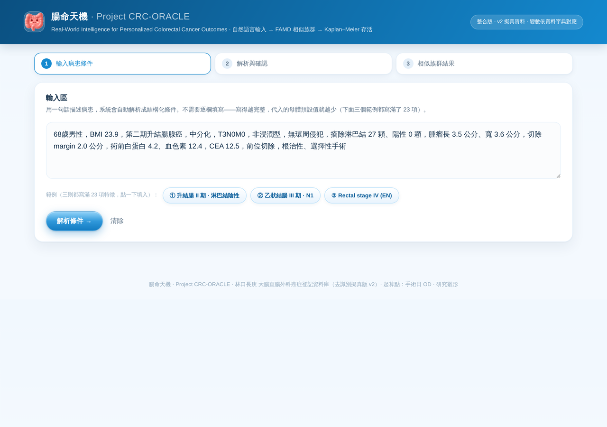
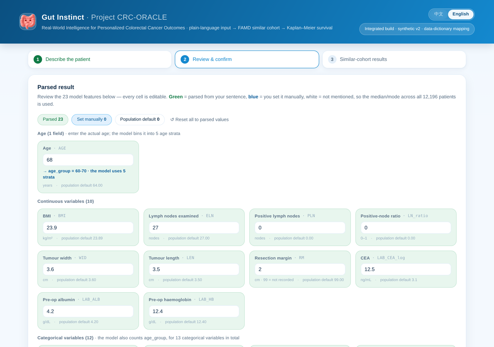
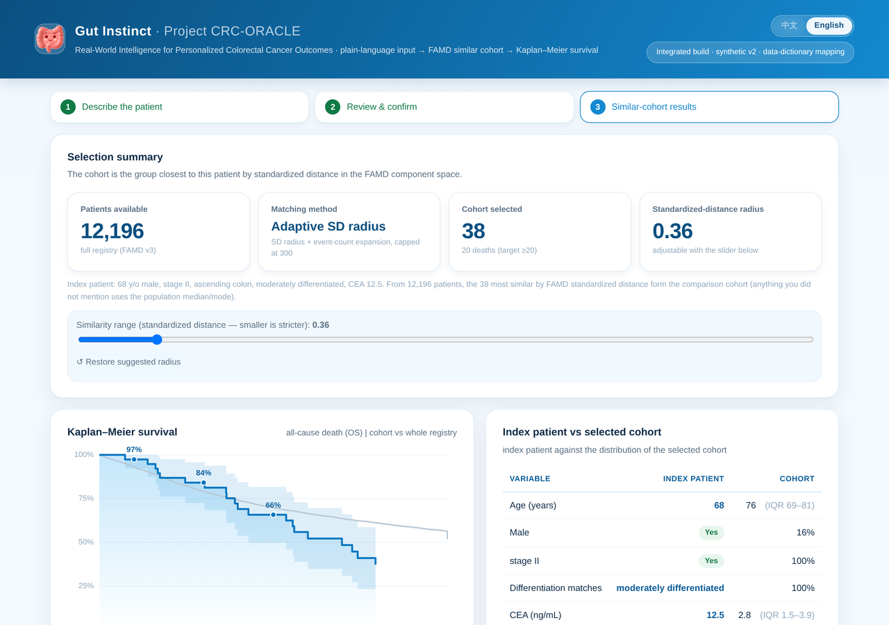
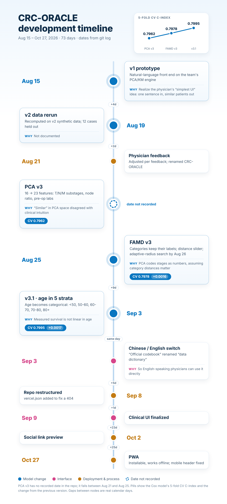

# 腸命天機 · Project CRC-ORACLE

**English** · [繁體中文](README.zh-TW.md)

> **Real-World Intelligence for Personalized Colorectal Cancer Outcomes**
> Describe a colorectal cancer patient in one plain sentence. The system finds the most similar patients in a 12,196-case registry and returns their survival curve and post-operative outcomes.

**Live demo → https://crc-oracle.vercel.app** · A StanCode SC201 project · Installable as a PWA, works offline

| 1 · Describe the patient | 2 · Review the parsed variables | 3 · Similar-cohort outcomes |
|---|---|---|
|  |  |  |

For the interface walkthrough, the model, and the cohort-size arithmetic, see [`03_website/deploy/README.md`](03_website/deploy/README.md).

## Development history: why this version

CRC-ORACLE went from a PCA prototype to the current age-layered FAMD model in about three weeks. The chart shows the 5-fold CV C-index (the adopted metric) at each model change, with the other events on the same timeline.



| When | Change | Why | Result |
|---|---|---|---|
| Aug 15 | v1 prototype | First deployment: natural-language front end + PCA / Kaplan–Meier engine | Starting point |
| Aug 19 | v2 data rerun | Recomputed on the v2 synthetic dataset, 12 cases held out for validation | Basis for all later versions |
| Aug 21 | Physician feedback | Adjustments requested by the physician (content not documented) | Renamed CRC-ORACLE |
| Aug 21–25 | PCA v3: 16 → 23 features | The 16 features lacked T/N/M substages and lymph-node ratio, so "similar" disagreed with clinical intuition | CV C-index 0.7962 |
| Aug 25 | PCA → FAMD v3 | PCA codes stages as numbers by hand, which assumes distances between categories mean something | CV 0.7978 (same level) |
| Aug 26 | Fixed K → adaptive radius | A fixed radius found 0 patients at 0.1 SD and 11 at 0.3 SD | Cohort grows to ≥ 20 death events |
| Sep 3 | Age in 5 strata | Measured survival is not linear in age | CV 0.7978 → **0.7995** |
| Sep 3 – Oct 27 | Interface and deployment | Chinese/English switch, clinical UI, `vercel.json`, PWA | Installable, works offline |
| Oct 28 | Cohort cap 300 → 1000; Gutty guide mascot | Physician suggested a larger cap; added in-page usage guide | Cohort 30–1000 |

Evaluation details, flowcharts and the gaps in the written record → **[full development history](04_docs_文件/DEVELOPMENT_HISTORY.md)**.

## Team

| Member | Role |
|---|---|
| 陳繹中 (lead) | Colorectal surgeon, Linkou Chang Gung Memorial Hospital: coordination, clinical validation, data source, UI direction |
| 陳奕閔 Steven Chen | UI/UX and front-end integration |
| 鄭文森 Kevin, Sean | Kevin: FAMD model and survival analysis. Sean: validation |

---

## Repository layout

```
CRC-ORACLE/
├── README.md                       ← you are here
├── 01_data_資料/                   raw data and codebook (kept locally, git-ignored)
├── 02_model_模型/                  FAMD training pipeline and model artifacts
│   ├── current_famd_age-layered_年齡分層版/   current model
│   └── archive_famd_20260823_舊版/            archived model
├── 03_website/                     single-file site (PWA)
│   └── deploy/                     the folder Vercel serves
├── 04_docs_文件/                   development history, methodology, reports
│   └── archive_封存/               outdated documents, kept as a record
├── 05_slides_簡報/                 slide decks (kept locally, git-ignored)
└── 99_assets_素材/                 old UI screenshots
```

> The repo root is the project root (`iminstevenchen/crc-oracle`). Vercel publishes `03_website/deploy`, as set in the root `vercel.json`.
> `.gitignore` excludes data files (csv / xlsx), model pickles (pkl) and slide decks (pptx), so those exist only on the local machine.

### 01_data_資料

| File | Description |
|---|---|
| `癌症資料20072023_AI去識別擬真版_v2.csv` | Raw data, 12,250 rows × 197 columns (AI de-identified synthetic version) |
| `癌症資料_欄位定義20260612.xlsx` | Column definitions |
| `癌症資料_資料字典與codebook.xlsx` | Data dictionary / codebook (basis for the natural-language parsing) |

> ⚠️ Keep the two data sources apart:
> - The **training pipeline** reads the **xlsx part1–3** files inside `02_model_模型/current_famd_age-layered_年齡分層版/` (`load_raw()` in `train_v3.py`).
> - **`export_frontend_famd_blob.py`** reads the **CSV** (for the LOS and MT columns).
>
> As of the Sep 3 inventory, the CSV and xlsx files in all three locations had identical md5 hashes (12,250 rows × 197 columns).

### 02_model_模型

| Folder | Status | Description |
|---|---|---|
| `current_famd_age-layered_年齡分層版/` | **Current** | Kevin's age-layered FAMD (formerly `5 age layer`). 10 continuous + 13 categorical variables, 5-fold CV C-index **0.7995** |
| `archive_famd_20260823_舊版/` | Archived | Earlier FAMD (formerly `FAMD_V3_20260823`). 11 continuous + 12 categorical, 5-fold CV 0.7978. The site ran this version before the age-layered model replaced it |

**The current folder holds two parallel pipelines. The website uses only the FAMD one:**

| File | Used by the site | Description |
|---|---|---|
| `train_famd_v3.py` | ✅ | FAMD training script |
| `artifacts_famd.pkl` | ✅ | Training output (FAMD encoder + all coordinates + Cox model) |
| `famd_coefficients_v3.json` | ✅ | PC1–PC5 explained variance and variable contributions |
| `export_frontend_famd_blob.py` | ✅ | **Exports the site's `F` blob from the pkl** (see workflow A) |
| `export_frontend_data_famd.py` | — | Kevin's original export for demo plots (scatter, coefficients, holdout) |
| `similarity_api_famd.py` | — | Python query module (`build_response`); the site is front-end only and does not call it |
| `validate_holdout.py` | — | 12-case holdout validation |
| `train_v3.py` | ⚠️ | PCA-era training script, but `train_famd_v3.py` runs `from train_v3 import load_raw, clean999, HOLDOUT_IDS`. **Required dependency; do not delete** |
| `癌症資料…_v2_part1~3.xlsx` | ⚠️ | What `load_raw()` actually reads for training (not the CSV). **Do not delete** |
| `artifacts.pkl` / `export_frontend_data.py` / `similarity_api.py` | ❌ | Earlier **PCA** pipeline, superseded by FAMD |

### 03_website

| File | Model version | Description |
|---|---|---|
| `deploy/index.html` | `v3-famd-age5` | **The only site source** (what is live). 23 manual inputs, PC1–PC5, cohorts capped at 1000, Chinese/English switch, PWA |
| other files in `deploy/` | — | `manifest.webmanifest`, `sw.js`, `icons/` (PWA), README screenshots, `DEPLOY.md` |

The site is a **single self-contained HTML file**. The 12,196 patients and the FAMD encoder are embedded in `const F={…}`, so it works offline with no backend.

### 04_docs_文件

| File | Description |
|---|---|
| **`DEVELOPMENT_HISTORY.md`** (English) / `發展歷程.md` (中文) | **How the versions evolved, why each change was made, how each was evaluated, with timeline and flowcharts** |
| `年齡分層方法學附錄.md` | Methodology appendix: why age is binned into 5 strata, with the supporting numbers (Chinese) |
| `腸命天機_Project_CRC-ORACLE_Milestone_Report.docx` | Milestone report (written before the age-layered model) |
| `archive_封存/` | Outdated documents: August progress reports, the PCA-era README, the Aug 26 slide handoff, the Sep 3 cleanup inventory |

### 05_slides_簡報 (local only, git-ignored)

| File | Description |
|---|---|
| `FINAL-CRC-ORACLE （2026-09-09).pptx` | Final presentation (Sep 9 version) |
| `FINAL-CRC-ORACLE_標題字體統一版.pptx` | Version with unified title fonts |
| `Steven_逐字稿_2頁.md` | Speaker script for Steven's section |
| `SC201 Apr2026 B組.png` | Image |

---

## Common workflows

### A. Replace the model and update the site (after Kevin retrains)

```bash
cd "02_model_模型/current_famd_age-layered_年齡分層版"
python train_famd_v3.py                                    # produces artifacts_famd.pkl
python export_frontend_famd_blob.py \
       --html "../../03_website/deploy/index.html"         # replaces the site's F blob in place
```

`export_frontend_famd_blob.py` exports everything the site needs in one pass: the FAMD encoder (`V` / `prop` / `outer_mean` / `outer_scale` / `pc_sd` / `cat_categories` / `cat_modes`) plus each patient's clinical and survival arrays. Kevin's original `export_frontend_data_famd.py` exports only three JSON files for plots, without the encoder or patient arrays, so the site cannot run on it alone.

**Environment:** run it in the same Python environment that ran `train_famd_v3.py` (the pkl contains `prince` FAMD objects). `lifelines` is not needed.

### B. Deploy

```bash
# from the repo root
git add 03_website/deploy/index.html && git commit -m "feat: update model"
git push origin main                                       # Vercel redeploys automatically
```

After changing the model or the page, bump `VERSION` in `03_website/deploy/sw.js` so installed PWAs drop their old cache.

---

## Technical highlights

- **FAMD (Factor Analysis of Mixed Data)** handles continuous and categorical variables in one decomposition. Continuous variables are z-scored; categorical variables are one-hot encoded and scaled as `(ind − p)/√p`; both pass through an outer StandardScaler and are projected onto the SVD's `V`.
- **Similar-cohort search.** The radius, in standardized distance, expands until the cohort holds at least 20 death events, with cohort size clamped to 30–1000. The user can set the radius by hand. If the radius contains nobody, the page says so instead of quietly padding with the nearest 30.
- **Survival analysis.** Kaplan–Meier with Greenwood 95% CI, plus in-hospital mortality (MT) and median post-operative length of stay.
- **Model quality.** Cox PH 5-fold CV C-index went from 0.7978 to **0.7995** with the age-layered model. Survival risk is not linear in age: after adjusting for the other variables, risk at 80+ is about 2.3 times that of ages 50–60. See [`年齡分層方法學附錄.md`](04_docs_文件/年齡分層方法學附錄.md).

### How 12,196 patients is derived

```
12,250  rows in the export (CSV / xlsx)
  − 42  follow-up ≤ 0 days (same-day admission and discharge, no real follow-up)
  − 12  held out for validation
─────
12,196  training sample, and the number shown on the site
```

The data have not changed since 2026-08-19; the old and new models use the same data (md5 compared).

### Hidden encoding rules of the site's `F` blob (reverse-engineered from the earlier version, now in the export script)

- `LOS` (post-operative length of stay) = the CSV's `DD − OD` (dates in the ROC calendar); 8 patients with a missing date are stored as `null`.
- `MT` is `1 = no / 2 = yes` in the CSV and `0/1` on the site (101 patients).
- Months are converted with **30.4368** days, not 30.4375.

---

## Limitations

The data are **v2 AI de-identified synthetic records** (12 holdout cases excluded, 12,196 patients used). Stage stratification behaves sensibly, but de-identification distorts clinical relationships between fields. **This is for methodology demonstration and research prototyping only: not for clinical decisions, and not citable as a clinical result.** The page states this limitation to the user directly.

**Deployment warning:** `index.html` embeds the entire dataset, so **anything deployed publicly can be downloaded in full.** That is acceptable for synthetic data. Never deploy a build containing real patient records this way. On Vercel's free plan, Settings → Deployment Protection can restrict access.
