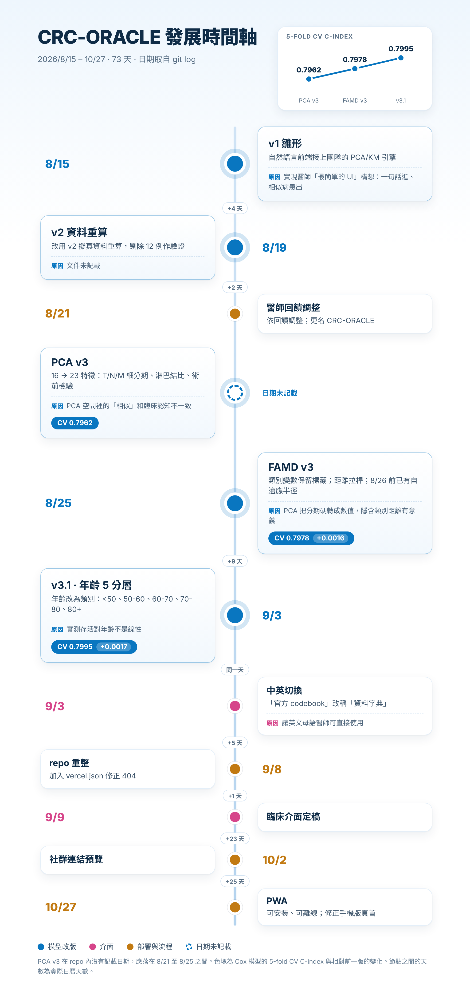

# 腸命天機 · Project CRC-ORACLE

[English](README.md) · **繁體中文**

> **Real-World Intelligence for Personalized Colorectal Cancer Outcomes**
> 大腸直腸癌相似病患智慧查詢 — 用一句自然語言描述病患，找出資料庫中最相似的一群病患，並給出存活曲線與術後結果。

線上 Demo：https://crc-oracle.vercel.app ｜ StanCode SC201 專題

## 發展歷程：為什麼用現在這個版本

CRC-ORACLE 約三週內，從 PCA 雛形演進到現行的年齡分層 FAMD 模型。下圖是每次改版時的 5-fold CV C-index（正式採用的指標），並把其他事件放在同一條時間軸上。



| 時間 | 改動 | 為什麼改 | 結果 |
|---|---|---|---|
| 8/15 | v1 雛形 | 首次上線：自然語言前端 + PCA／Kaplan–Meier 引擎 | 起點 |
| 8/19 | v2 資料重算 | 改用 v2 擬真資料，剔除 12 例作驗證 | 後續版本的基礎 |
| 8/21 | 醫師回饋調整 | 醫師提出調整（內容文件未記載） | 更名 CRC-ORACLE |
| 8/21–25 | PCA v3：16 → 23 特徵 | 16 特徵缺 T/N/M 細分期、淋巴結比率，「相似」與臨床認知不一致 | CV C-index 0.7962 |
| 8/25 | PCA → FAMD v3 | PCA 把分期人工轉成數值，隱含「類別間距離有意義」的假設 | CV 0.7978（同一水準） |
| 8/26 | 固定 K → 自適應半徑 | 固定半徑在 0.1 SD 找到 0 人、0.3 SD 只有 11 人 | 擴張到死亡事件 ≥ 20 |
| 9/3 | 年齡 5 分層 | 實測存活對年齡不是線性 | CV 0.7978 → **0.7995** |
| 9/3 – 10/27 | 介面與部署 | 中英切換、臨床介面、`vercel.json`、PWA | 可安裝、可離線 |
| 10/28 | 人數上限 300 → 1000；Gutty 小幫手 | 醫師建議放大上限；新增頁內使用說明 | 人數 30–1000 |

評估細節、流程圖與書面紀錄的缺口 → **[完整發展歷程](04_docs_文件/發展歷程.md)**。

## 資料與隱私

**本 repo 不含任何真實病患紀錄。** CRC-ORACLE 使用的是臨床負責人（陳繹中）提供的「**AI 去識別化擬真版**」資料，僅供方法示範與研究原型。

| 項目 | 是否在本 repo？ |
|---|---|
| 原始資料檔（`.csv`、`.xlsx`） | **否。** 已被 `.gitignore` 排除，從未提交（見 [`01_data_資料`](01_data_資料/README.md)） |
| 模型檔（`.pkl`） | 否，已排除 |
| 內嵌於公開網站（`03_website/deploy/index.html`）的**擬真資料**逐筆矩陣 | **是。** 網站為了免後端運作所需 |
| 姓名、病歷號、身分證字號、聯絡方式、醫院名稱 | **否。** 從未出現 |
| 真實日期 | **否。** 只有推算出的天數 |

**網站對 12,196 筆擬真紀錄各內嵌的欄位：** 流水號、存活時間與事件、術後住院天數、院內死亡，以及模型的 23 項臨床變數（年齡只以 5 個分層呈現）。

**你可以自己驗證。** 下列指令不會輸出任何內容，因為從未提交過資料檔：

```bash
git log --all --oneline -- '*.csv' '*.xlsx' '*.pkl'
```

**限制。** 結果描述的是擬真族群，並非診斷、預後預測或治療建議，不可引用為臨床發現。網站是公開的，任何人都能下載內嵌的擬真矩陣；切勿以這種方式部署含真實病患紀錄的版本。
<!-- TODO: 待與臨床負責人確認後，補上擬真資料的產生方式與倫理審查（IRB）說明。 -->

## 團隊分工
| 成員 | 角色 |
|---|---|
| 陳繹中（組長） | 林口長庚大腸直腸外科主治醫師 — 專案協調、臨床驗證、資料來源、UI 方向 |
| 陳奕閔 Steven | UI/UX 與前端整合 |
| 鄭文森 Kevin、Sean | Kevin：FAMD 模型與存活分析；Sean：驗證 |

---

## 資料夾導覽

```
CRC-ORACLE/
├── README.md                       ← 你在這裡 · you are here
├── 01_data_資料/                   原始資料與 codebook · raw data & codebook
├── 02_model_模型/                  FAMD 訓練管線與模型產物 · training pipeline & artifacts
│   ├── current_famd_age-layered_年齡分層版/   現行模型 · current model
│   └── archive_famd_20260823_舊版/            封存模型 · archived model
├── 03_website/                     單檔網站（PWA）· single-file site (PWA)
│   └── deploy/                     ← Vercel 服務的那一層 · the folder Vercel serves
├── 04_docs_文件/                   報告與交接文件 · reports & handover docs
│   └── archive_封存/
├── 05_slides_簡報/                 最終簡報（其餘草稿僅存本機）
│   └── archive_封存/
└── 99_assets_素材/                 截圖素材 · screenshots
```

> ℹ️ **repo 根目錄＝專案根目錄**（`iminstevenchen/crc-oracle`），Vercel 依根目錄 `vercel.json` 發佈 `03_website/deploy`。
> `.gitignore` 排除資料檔（csv / xlsx）、模型檔（pkl）、簡報（pptx）等大檔，這些只存在於本機。

### 01_data_資料
| 檔案 | 說明 |
|---|---|
| `癌症資料20072023_AI去識別擬真版_v2.csv` | 原始資料，12,250 列 × 197 欄（AI 去識別擬真版） |
| `癌症資料_欄位定義20260612.xlsx` | 欄位定義 |
| `癌症資料_資料字典與codebook.xlsx` | 官方 codebook（自然語言解析的對照依據） |

> ⚠️ 兩份資料來源要分清楚：
> - **訓練管線**讀的是 `02_model_模型/current_famd_age-layered_年齡分層版/` 底下的 **xlsx part1~3**（`train_v3.py` 的 `load_raw()`）
> - **`export_frontend_famd_blob.py`** 讀的是 **CSV**（取 LOS / MT 兩個欄位）
>
> 三個位置的 CSV 與 xlsx md5 都相同，內容一致（12,250 列 × 197 欄）。

### 02_model_模型
| 資料夾 | 狀態 | 說明 |
|---|---|---|
| `current_famd_age-layered_年齡分層版/` | **現行** | Kevin 的 age-layer FAMD（原名 `5 age layer`）。10 連續 + 13 類別變項，cv5 C-index **0.7995** |
| `archive_famd_20260823_舊版/` | 封存 | 8/22 舊版 FAMD（原名 `FAMD_V3_20260823`）。11 連續 + 12 類別，cv5 0.7978。網站曾跑這一版，現已由 age 分層版取代 |

**`current_famd_age-layered_年齡分層版/` 裡的檔案分兩套管線 —— 網站只用 FAMD 那套：**

| 檔案 | 網站有用到 | 說明 |
|---|---|---|
| `train_famd_v3.py` | ✅ | FAMD 訓練主程式 |
| `artifacts_famd.pkl` | ✅ | 訓練產物（FAMD 編碼器 + 全體座標 + Cox） |
| `famd_coefficients_v3.json` | ✅ | PC1–PC5 解釋變異與欄位貢獻度 |
| `export_frontend_famd_blob.py` | ✅ | **從 pkl 匯出網站的 `F` blob**（見下方「換模型流程」） |
| `export_frontend_data_famd.py` | — | Kevin 原本的展示用匯出（散佈圖 / 係數 / holdout） |
| `similarity_api_famd.py` | — | Python 查詢模組（`build_response`）；網站是純前端，不呼叫它 |
| `validate_holdout.py` | — | 12 人 holdout 驗證（簡報數字的佐證） |
| `train_v3.py` | ⚠️ | PCA 版訓練程式，但 `train_famd_v3.py` 會 `from train_v3 import load_raw, clean999, HOLDOUT_IDS` —— **必要相依，不可刪** |
| `癌症資料…_v2_part1~3.xlsx` | ⚠️ | `load_raw()` 實際讀的訓練資料來源（不是 CSV）—— **不可刪** |
| `artifacts.pkl` / `export_frontend_data.py` / `similarity_api.py` | ❌ | 更早的 **PCA** 管線，已被 FAMD 取代 |

### 03_website
| 檔案 | 模型版本 | 說明 |
|---|---|---|
| `deploy/index.html` | `v3-famd-age5` | **唯一的網站來源**（＝線上版）。含 23 項手動輸入、PC1–PC5、1000 人上限、中英切換、PWA |
| `deploy/` 其他檔案 | — | `manifest.webmanifest`、`sw.js`、`icons/`（PWA）、README 截圖、`DEPLOY.md` |

Vercel 的輸出目錄由根目錄 `vercel.json` 指定為 `03_website/deploy`；repo 根目錄就是 git repo 根目錄。

網站是**單一自包含 HTML**：12,196 位病患的資料與 FAMD 編碼器全部內嵌在 `const F={…}` 裡，離線可用、無後端。

### 04_docs_文件
| 檔案 | 說明 |
|---|---|
| **`DEVELOPMENT_HISTORY.md`** / `發展歷程.md` | **版本怎麼演變、每次為什麼改、用什麼評估（含流程圖與數字對照）；英文版與中文版** |
| `年齡分層方法學附錄.md` | 年齡改 5 分層的做法與實測證據 |
| `腸命天機_Project_CRC-ORACLE_Milestone_Report.docx` | 里程碑報告（早於 FAMD 年齡分層版） |
| `archive_封存/` | 過時文件：8 月進度報告、PCA 時期 README、8/26 簡報交接、9/3 資料夾清理清單 |

### 05_slides_簡報

最終簡報 `FINAL-CRC-ORACLE_標題字體統一版.pptx` 已公開於此，其餘檔案僅存本機（`.gitignore` 排除）。
| 檔案 | 說明 |
|---|---|
| `FINAL-CRC-ORACLE （2026-09-09).pptx` | 期末簡報（9/9 版） |
| `FINAL-CRC-ORACLE_標題字體統一版.pptx` | 標題字體統一後的版本 |
| `Steven_逐字稿_2頁.md` | Steven 負責段落的逐字稿 |
| `SC201 Apr2026 B組.png` | 圖檔 |


---

## 常用流程

### A. 換模型 → 更新網站（Kevin 重訓之後）

```bash
cd "02_model_模型/current_famd_age-layered_年齡分層版"
python train_famd_v3.py                                    # 產生 artifacts_famd.pkl
python export_frontend_famd_blob.py \
       --html "../../03_website/deploy/index.html"                 # 就地換掉網站的 F blob
```

`export_frontend_famd_blob.py` 一次匯出網站需要的全部：FAMD 編碼器（`V` / `prop` / `outer_mean` / `outer_scale` / `pc_sd` / `cat_categories` / `cat_modes`）＋ 每位病患的臨床與存活陣列。
Kevin 原本的 `export_frontend_data_famd.py` 只匯出展示用的三個 JSON，不含編碼器與病患陣列，所以網站無法只靠它運作。

**環境需求**：要在跑過 `train_famd_v3.py` 的同一個 Python 環境執行（pkl 內含 prince 的 FAMD 物件）。不需要 lifelines。

### B. 部署

```bash
# 在 repo 根目錄執行
git add 03_website/deploy/index.html && git commit -m "feat: 更新模型"
git push origin main                                       # Vercel 自動重新部署
```

更新模型或網頁後，記得把 `03_website/deploy/sw.js` 的 `VERSION` 加 1，已安裝的 PWA 才會丟掉舊快取。

---

## 技術重點

- **FAMD（Factor Analysis of Mixed Data）** — 同時處理連續與類別變項的降維。連續變項 z-score、類別變項 one-hot 後做 `(ind − p)/√p`，再經外層 StandardScaler，投影到 SVD 的 `V`。
- **相似族群搜尋** — 以標準化距離為半徑自適應擴張，直到累積死亡事件數 ≥ 20，人數夾在 30–1000 之間。半徑可由使用者手動調整；半徑內無人時顯示誠實的空狀態，不會偷偷補最近 30 位。
- **存活分析** — Kaplan–Meier + Greenwood 95% CI；另呈現手術死亡率（MT）與中位術後住院天數。
- **模型品質** — Cox PH 的 5-fold CV C-index：舊版 0.7978 → age 分層版 **0.7995**（存活風險對年齡非線性：調整其他變項後，80+ 的風險約為 50–60 歲的 2.3 倍，詳見 `04_docs_文件/年齡分層方法學附錄.md`）。

### 病患人數怎麼算出 12,196
```
12,250  原始列數（CSV / xlsx）
  − 42  追蹤天數 ≤ 0（同日進出、無真實追蹤資訊）
  − 12  holdout 驗證病例
─────
12,196  訓練樣本，也是網站上的數字
```
資料版本自 2026-08-19 起未變動；新舊模型用的是同一份資料（md5 已比對）。

### 網站 `F` blob 的隱藏編碼規則（反推自舊版，已寫進匯出腳本）
- `LOS`（術後住院天數）＝ CSV 的 `DD − OD`（民國日期），8 位缺日期存 `null`
- `MT` CSV 用 `1=否 / 2=是`，網站存 `0/1`（共 101 位）
- 「月」換算基準是 **30.4368**（不是 30.4375）

---

## 重要限制

目前使用 **v2 去識別擬真資料**（剔除 12 例 holdout，納入 12,196 位）。期別分層已呈合理臨床分離，但仍為去識別擬真資料，**僅供方法學與研究示範，不可作為臨床判讀或投稿依據**。網站頁面上已明確標註。

部署注意：`index.html` 內嵌全部病患資料，**公開網址 = 任何人都能下載這份資料**。合成版可以展示，但絕不可用同樣方式部署含真實病患資料的版本。Vercel 免費版可用 Settings → Deployment Protection 限制存取。
